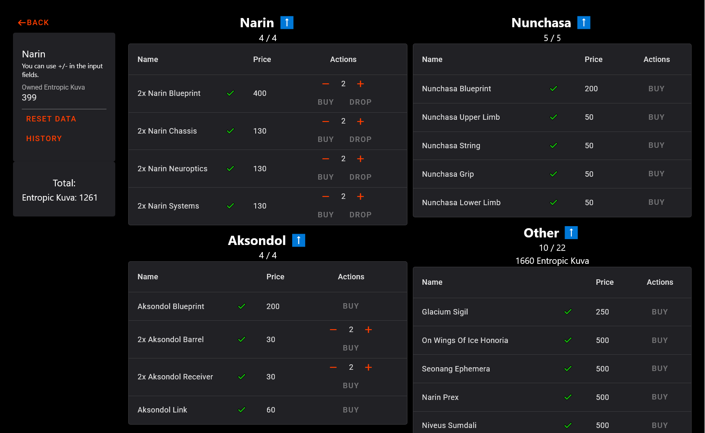

Tool for tracking the resources and currencies needed to purchase Warframes, weapons, and cosmetics from in-game vendors. Inspired by [Framehub Mastery Checklist](https://framehub.paroxity.net/).



### Development

- Use [PNPM](https://pnpm.io/)

```
git clone
pnpm install

# compile translations (/messages/*.json)
pnpm run paraglide
# start on http://localhost:5173
pnpm run dev
```

- **After modifying translations, remember to rerun `pnpm run paraglide`**
- Run tests: `pnpm run test`
- Svelte / TS check: `pnpm run check`

### TODO

- Features
  - stats page for all warframes (% of completion, how much resources needed etc.)
  - tooltip functionality (notes for parts, custom resources for Honoria)
  - wiki links (maybe ctrl-click)

- Factions:
  - the quills
  - ostron
  - solaris united
  - vox solaris
  - ventkids
  - entrati
  - necraloid
  - the hex
  - the holdfasts
  - cavia
  - kahl's garrison
  - nightcap
  - operational supply
  - nightwave wares
